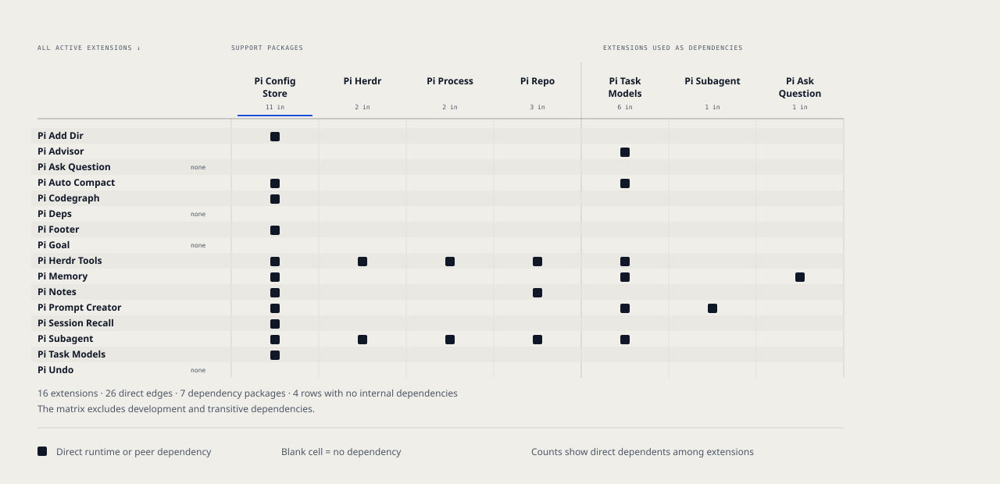

# hcflabs Pi Harness

[](https://github.com/hcflabs/pi-harness/blob/main/LICENSE)
[](https://www.npmjs.com/~hcflabs)

Pi extensions for subagents, memory, Herdr panes, and other agent workflows. These extensions use strong workflow preferences, so read each package guide before you install it. The guides are the README files in [`extensions/`](https://github.com/hcflabs/pi-harness/tree/main/extensions) and [`packages/`](https://github.com/hcflabs/pi-harness/tree/main/packages).

## Install

```sh
curl -fsSL https://raw.githubusercontent.com/hcflabs/pi-harness/main/website/public/install.sh | sh
```

The installer does these steps:

1. Installs Pi and Herdr if they are missing, and stops if a version is below the minimum.
2. Shows the installed Pi and Herdr versions and asks before it updates either tool.
3. Asks which extensions to install: all (the default), a selection, or none.
4. Installs the selected extensions from npm.

Without an interactive terminal, the installer installs all extensions and does not update Pi or Herdr.

| Option | Effect |
| --- | --- |
| `--all` | Install all extensions without a prompt. |
| `--update` | Approve available Pi and Herdr updates without a prompt. |

```sh
curl -fsSL https://raw.githubusercontent.com/hcflabs/pi-harness/main/website/public/install.sh | sh -s -- --update
```

To install one extension, use Pi directly, for example `pi install npm:@hcflabs/pi-undo`.

## Extension dependencies

Each row shows an active extension. A filled square marks a **direct** runtime or peer dependency on the package above its column. Empty rows have no internal dependencies. Column counts show how many extensions depend directly on that package.



The matrix excludes development and transitive dependencies.

## Development

The repository is a pnpm workspace. Extensions are in `extensions/`, support libraries are in `packages/`, and the documentation website is in `website/`.

```sh
pnpm install
pi -e ./extensions/pi-undo/extensions/undo.ts
```

`pnpm install` also builds the support libraries. Use `pi -e` with an extension entry file to test that extension from source.

CI runs these checks on each pull request:

| Command | Check |
| --- | --- |
| `pnpm test` | Repository script tests, eval tests, and the tests of each workspace package. |
| `pnpm run typecheck` | TypeScript types in each package. |
| `pnpm run pack:check` | The npm artifact of each published package. |
| `pnpm run docs:validate` | The installer list, README structure, Simplified Technical English rules, and the website. |
| `pnpm run check:package-versions` | Version bumps for changed published files. |

To release a package, follow [the release runbook](https://github.com/hcflabs/pi-harness/blob/main/docs/releasing.md).
